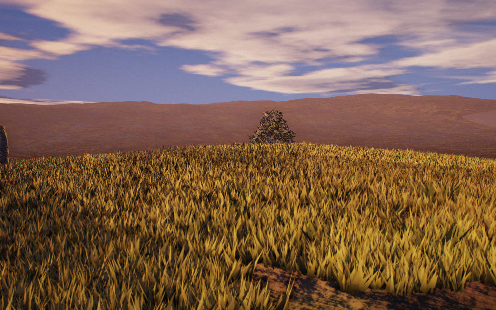

# Mesh Painting

Paint landscapes, coasts and buildings from editable Python scenes. Mesh Painting builds triangle meshes, renders procedural materials with sunlight, shadows, water and lens effects, then paints the result in seven brushstroke passes. It uses CPU code, without photographs, downloaded textures or an image-generation model.

If Mesh Painting is useful to you, [star the repo on GitHub](https://github.com/dansasser/skills).


*The bundled lighthouse scene, painted at golden hour.*



*The bundled moor scene, with layered terrain, scattered grass and stones.*

The reusable skill instructions live in [SKILL.md](SKILL.md). The renderer also runs directly from a terminal. A scene remains ordinary Python source: change its camera, geometry, materials or lights and render another revision.

## Requirements

- **Linux** with procfs mounted for the current PID namespace and `findmnt` from util-linux. The environment must permit process forking, signals, file locking and enforced `RLIMIT_AS` address-space limits. Restricted containers may prevent these operations.
- **Python 3.10 or newer**, with `venv` and pip available for that interpreter. The tested combinations are listed under [verification](#verification); newer versions still need compatible dependency builds.
- **NumPy, SciPy and Pillow**, installed from [requirements.txt](requirements.txt).
- **An image viewer**, or an agent tool that can open PNGs at full resolution. Inspection is part of the workflow.
- **An optional C compiler**: `cc`, GCC or Clang. The engine compiles its bundled C core on first use. The Python implementation works without a compiler and is much slower. A GPU, model weights and API keys are unnecessary.

The default `standard` level permits up to 5,120 MiB of process address space and ten minutes per stage. This is a ceiling, not a reservation of physical RAM. The host needs enough available memory for the scene and its other running programs. See [resource levels and recovery](references/limits.md).

Native Windows, macOS and hosted ChatGPT execution have not been verified. Run the engine in a Linux environment that meets these prerequisites.

## Get the source

```sh
git clone https://github.com/dansasser/skills.git
cd skills/skills/mesh-painting
python3 -m venv .venv
export OPENBLAS_NUM_THREADS=1 OMP_NUM_THREADS=1
.venv/bin/python -m pip install -r requirements.txt
.venv/bin/python scripts/run.py --help
```

The thread controls above keep numerical-library concurrency explicit. Use this same `.venv/bin/python` for installation, checks and rendering. If you select a different Python version, use that interpreter to create the environment first. Runtime installation downloads the three declared Python dependencies; rendering itself needs no network service.

## Paint the lighthouse

Run these commands from the repository root. Copy the scene into an ignored workspace so the bundled example stays intact:

```sh
mkdir -p workspace
cp assets/scenes/lighthouse.py workspace/lighthouse.py
.venv/bin/python scripts/run.py workspace/lighthouse.py --look golden_hour --seed 11 --out workspace/out/lighthouse --stage preview
```

Open `workspace/out/lighthouse_preview.png`. Check framing, proportions, lighting and exposure. Edit `workspace/lighthouse.py` to change the scene, then repeat the preview. Scene files execute Python with your account's permissions: review a scene before running it. The launcher limits rendering resources; it does **not** sandbox file access, network access or malicious code.

When the composition is ready, render at the working resolution:

```sh
.venv/bin/python scripts/run.py workspace/lighthouse.py --look golden_hour --seed 11 --out workspace/out/lighthouse --stage render
```

Open `workspace/out/lighthouse_render.png` and **all six** files from `lighthouse_render_tile_r1c1.png` through `lighthouse_render_tile_r2c3.png`. View each tile at its original resolution. Check foreground and background for mesh seams, floating objects, stretched triangles, excessive blur and material defects. Correct the scene and repeat the render until it is ready.

Then paint using the same scene and settings:

```sh
.venv/bin/python scripts/run.py workspace/lighthouse.py --look golden_hour --seed 11 --out workspace/out/lighthouse --stage paint
```

Painting renders the scene again internally; it does not load the earlier render PNG. Keep the scene, seed, look, sun, level and scale unchanged between the inspected render and paint. Open `lighthouse.png`, `lighthouse_full.png` and every painted tile. Deliver the scene source with the painting.

For the second example, copy `assets/scenes/moor.py` to `workspace/moor.py` and repeat the three commands with `workspace/moor.py` and the output prefix `workspace/out/moor`. Use `standard`: the moor exceeds the geometry caps of `draft`.

### Outputs

These dimensions apply to either bundled 1600 × 1000 scene at the default `standard` scale of 2.4 and default 3 × 2 tile grid. All names below follow the chosen output prefix.

| File suffix | Stage | Size or purpose |
| --- | --- | --- |
| `_preview.png` | Preview | 1600 × 1000 composition check; preview always uses scale 1 |
| `_render.png` | Render and paint | 1600 × 1000 shaded scene |
| `_render_tile_r1c1.png` … `_render_tile_r2c3.png` | Render | Six 1280 × 1200 adjacent crops of the working render |
| `.png` | Paint | 1600 × 1000 delivery image, downsampled from the full canvas |
| `_full.png` | Paint | 3840 × 2400 full painted canvas |
| `_tile_r1c1.png` … `_tile_r2c3.png` | Paint | Six 1280 × 1200 adjacent crops of the painted canvas |
| `_partial.png` | Best effort after a paint resource stop | 1600 × 1000 checkpoint after a completed pass, before final relief shading and grain; label it unfinished |
| `_usage.json` | After a supervised stage | Outcome, limits, usage, image ownership and cleanup report |
| `.pid` | While active | Process identity used by `--stop`; normally removed at completion |
| `.lock` | Persistent | Output-prefix ownership lock; an idle file is normal |

Tiles cover the full working canvas without overlap. Other sizes or tile grids can produce uneven edge tiles. `--tiles 0` disables tile output; use tiles for visual review. The editable scene is the copy you created, not a file exported by the renderer.

Reusing a prefix replaces that stage's completed outputs. A failed run preserves earlier completed images; their presence alone does not prove the new run succeeded. Use `_usage.json` and the command's exit status. `images_kept` describes primary images and whether this run wrote them; `images_written_by_this_run` also includes newly written tiles. See the [report reference](references/limits.md#usage-report).

### Revisions and repeatability

Keep the original scene and output prefix when comparing revisions. For example, copy `workspace/lighthouse.py` to `workspace/lighthouse-v2.py`, edit the copy, and use `--out workspace/out/lighthouse-v2` through preview, render and paint. Keep the same camera and seed unless the requested change calls for changing them.

The default seed is 11. Scene authors should use `scene_rng(name)` for repeatable independent random streams. Record the scene file, its hash, engine revision and complete command alongside important outputs. The usage report records the scene path, but does not record its hash, seed, look, sun or tile grid. Repeated runs in the same environment are tested; images can vary across Python and numerical-library versions, including painted stroke placement.

## Install for an agent

Install this skill from the shared `dansasser/skills` repository with the Skills CLI. The tested CLI version below requires Node.js 22.20 or newer and Git. Run from your working project:

```sh
npx skills@1.9.0 add dansasser/skills --skill mesh-painting --copy
```

Choose your agent when prompted, or specify `--agent codex` or `--agent claude-code`. `--copy` installs independent files. Add `--global` for a user-wide installation after reviewing its destination. To select this published version, use `dansasser/skills@mesh-painting-v0.1.0` in place of `dansasser/skills`. [Skills CLI options](https://github.com/vercel-labs/skills/blob/main/docs/commands.md#skills-add)

For manual installation, clone the collection and copy its complete `skills/mesh-painting` folder to the appropriate location. Keep `SKILL.md`, scripts, references, assets and the license together. Preserve any existing installation before replacing it.

| Agent | Current project | All projects for your user | Explicit invocation |
| --- | --- | --- | --- |
| Codex | `.agents/skills/mesh-painting/` | `~/.agents/skills/mesh-painting/` | `$mesh-painting` |
| Claude Code | `.claude/skills/mesh-painting/` | `~/.claude/skills/mesh-painting/` | `/mesh-painting` |

These follow the documented folder conventions for [Codex](https://learn.chatgpt.com/docs/build-skills) and [Claude Code](https://code.claude.com/docs/en/skills). The agent needs command execution in the Linux runtime above and a PNG-viewing tool. Start a fresh session in your project and invoke the skill explicitly.

Create the Python environment in your working project and install from the installed skill's requirements. For a Codex project installation:

```sh
python3 -m venv .venv
export OPENBLAS_NUM_THREADS=1 OMP_NUM_THREADS=1
.venv/bin/python -m pip install -r .agents/skills/mesh-painting/requirements.txt
mkdir -p workspace
cp .agents/skills/mesh-painting/assets/scenes/lighthouse.py workspace/lighthouse.py
.venv/bin/python .agents/skills/mesh-painting/scripts/run.py workspace/lighthouse.py --look golden_hour --seed 11 --stage preview --out workspace/out/lighthouse
```

Use `.claude/skills/mesh-painting` for a Claude Code project installation. Continue with render and paint using that same project interpreter and installed launcher. Keep editable scenes and output in the project, outside the skill. The full workflow above runs from the skill's source folder; these installed commands resolve its resources from the agent's skill directory instead.

Try: “Use mesh-painting to paint a rocky coast at golden hour. Keep the scene editable and inspect the preview and every render tile before painting.” Source relocation, installer file placement and direct renderer output are separate from fresh-agent discovery and workflow acceptance; verify the latter in the agent session you use.

## Command reference

```sh
.venv/bin/python scripts/run.py --help
```

| Option | Meaning |
| --- | --- |
| `SCENE` | Python module defining `build() -> Scene`; paths resolve from the caller's directory |
| `--out PREFIX` | Output filename prefix, default `out/painting`; parent directories are created |
| `--stage preview\|render\|paint` | Default `preview` |
| `--level draft\|standard\|high` | Resource profile, default `standard` |
| `--scale NUMBER` | Positive finite working scale for render/paint; both dimensions scale and all profile caps still apply |
| `--look sunset\|golden_hour` | Override the scene's look |
| `--sun OFFSET ELEV` | Override the sun in degrees from viewing direction and above the horizon; takes precedence over `--look` |
| `--tiles COLSxROWS` | Crop grid, default `3x2`; `0` disables crops |
| `--seed INTEGER` | Procedural seed, default 11 |
| `--time-limit SECONDS` | Lower the chosen profile's wall-clock ceiling |
| `--memory-limit MIB` | Lower its address-space ceiling; minimum 768 MiB |
| `--stop` | Stop the active run owning `--out`; no scene argument needed |

Arguments containing spaces must be quoted. The launcher finds its package relative to itself; the current directory need not be the skill directory. A custom scale can exceed a profile's default scale for a small scene if its pixel and stroke counts still fit the profile.

To stop a background run, use the same output prefix from the same working directory:

```sh
.venv/bin/python scripts/run.py --stop --out workspace/out/lighthouse
```

Ctrl+C also requests cancellation. Another run using the same prefix is refused with exit 2 while ownership is active; different prefixes can run independently, subject to host resources. Keep the `.lock` file in place. [Cancellation, recovery and reports](references/limits.md#stopped-or-failed-runs)

## Performance and the native core

The bundled examples were measured on a six-core x86-64 Linux CPU, with native C enabled and `OPENBLAS_NUM_THREADS=1` and `OMP_NUM_THREADS=1`. Observed standard runs took about 9 seconds for preview, 45 seconds for render and roughly three minutes for paint, including its internal render. Other verification jobs shared the host during those measurements. These are measurements, not deadlines or performance guarantees. Hardware, scene density, dependencies, compilation and other jobs affect timing.

At standard size the engine lays 2,996,000 strokes. Raising scale increases canvas area, stroke count and memory. Preview still builds all scene geometry. The moor has about 2.5 million vertices and 1.7 million triangles; reducing only the image scale will not reduce those counts.

If C is unavailable, begin with a small working canvas. This tested fallback paints a coarse 400 × 250 canvas, upscales the delivery image to 1600 × 1000 and writes no tiles:

```sh
MESHPAINT_NO_NATIVE=1 .venv/bin/python scripts/run.py workspace/lighthouse.py --look golden_hour --seed 11 --stage paint --scale 0.25 --tiles 0 --out workspace/out/lighthouse-python
```

It is a fallback check with visibly reduced detail. Full standard painting on the Python core can exceed the default time limit. The [limits reference](references/limits.md#resource-levels) explains profile selection and reductions.

### Cache and environment

The native cache is under `meshpaint/native-v2/<core-source-sha256>/` inside `XDG_CACHE_HOME`, or the user's default `.cache` directory. It contains `core.so`, `core.json` and `build.lock`. Private cache directories use mode 0700 and files 0600. The loader checks directory ancestry, ownership, permissions, links, source/build receipts and library hashes, coordinates builds with a lock and loads a verified file descriptor. Unsafe primary caches fall back to a new private temporary directory; if a trusted native build cannot be loaded, the engine uses Python. Old predictable temporary caches are not reused.

| Variable | Effect |
| --- | --- |
| `CC` | Compiler command tried first, then `cc`, `gcc`, `clang`; shell-style tokenization supports compiler arguments and quoted paths containing spaces |
| `XDG_CACHE_HOME` | Cache parent; use a trusted user-owned location with secure ancestors |
| `MESHPAINT_NO_NATIVE=1` | Force Python rasterization and strokes |
| `OPENBLAS_NUM_THREADS`, `OMP_NUM_THREADS` | Numerical-library thread controls; the launcher honors caller values; the checker defaults them to 1 when unset |
| `TMPDIR` | Standard Python temporary-directory selection; the native loader still requires trusted directory ancestry |
| `MESHPAINT_SLOW=1` | Enable slow checks, equivalent to `tools/check.py --slow` |

If a cache is rejected, inspect the printed reason and directory ownership/permissions. Do not make shared directories writable to bypass the checks. No compiled library is bundled in the repository.

## Write a scene

A scene module exposes `build()` returning a `meshpaint.scene.Scene`. The launcher supplies the bundled package on the import path. See the [scene API](references/scene-api.md) for a runnable minimal scene, camera coordinates, geometry builders, material and bump callbacks, lights, water, deterministic randomness and paint-region IDs.

Start with [lighthouse.py](assets/scenes/lighthouse.py) for coastal geometry, structures and lamps, or [moor.py](assets/scenes/moor.py) for terrain, grass and stones. Region IDs must be integers from 2 through 127; dense low IDs keep mask memory down.

## Troubleshooting

| Symptom | Action |
| --- | --- |
| Missing NumPy, SciPy or Pillow | Install requirements with the same interpreter used for the launcher; check `.venv/bin/python -m pip --version` |
| Cannot create the virtual environment | Install your distribution's venv/pip support for the selected Python, then recreate it |
| procfs or supervision error | Check `findmnt`, a procfs mount for the current PID namespace, and permission to fork, signal and enforce address-space limits |
| Native compiler/cache error or very slow paint | Read the native fallback reason; install a C compiler or choose a trusted cache location; verify a small Python fallback first |
| Invalid region | Use Python or NumPy integers 2–127 for `regions` and `default_region`; booleans are invalid |
| Exit 3 / `stopped` | Read the report's limiting resource and stage; reduce geometry, scene size or scale as appropriate; raising a level is an explicit resource choice |
| Traceback / `failed` | Correct the reported scene or environment error; non-finite values are rejected before image conversion |
| Exit 130/143 / `interrupted` | Check preserved images and the cleanup report; retry with a new prefix after the old run exits |
| Earlier image is still present | Check `result` and `written_by_this_run`; preserved files can predate this attempt |
| Visual defects | Consult [known limits and modelling fixes](references/limits.md#scene-limitations); inspect the underlying render before changing brushwork |

## Verification

```sh
.venv/bin/python tools/check.py
.venv/bin/python tools/check.py --slow
```

The first runs the default checks; the second enables full-size, performance and process-control checks and can take around 17 minutes on the measured host. They use the selected interpreter and exit nonzero on failures. Select tests with `--test NAME`; use `--help` for syntax.

Before collection packaging, full 125-method suites were run on Linux x86-64 with these combinations. The collection also includes regression checks for interruption during dependency loading and genuine import failures:

| Python | NumPy | SciPy | Pillow | Result |
| --- | --- | --- | --- | --- |
| 3.14.4 | 2.5.5 | 1.18.1 | 13.0.0 | 125 passed, no skips |
| 3.10.22 | 2.2.6 | 1.15.3 | 12.3.0 | 123 passed, 2 reference-profile skips |
| 3.10.22 | 1.21.6 | 1.7.3 | 8.4.0 | 123 passed, 2 reference-profile skips |

Four historical PNG hashes are enforced only under their exact reference runtime, including zlib 1.3.1. Other environments explicitly skip the two historical-reference methods while retaining portable behavior, parity, safety and repeatability checks. The dependency floors above were exercised; every intermediate Python/library combination has not been tested.

The inspected examples have visible limitations: stretched cloud layers, repetitive grass geometry, simplified buildings, saturated bright lamps and coarse brushwork at low scales. See [limits and fixes](references/limits.md). Frozen agent-evaluation prompts are in [evals/cases.md](evals/cases.md); they are evaluation criteria, not a claim of acceptance by every agent product.

## License

Published by **Dan Sasser** under the [MIT License](LICENSE). The license covers this skill folder's code, instructions and documentation, bundled scene sources and gallery images. Third-party dependencies retain their own licenses.
